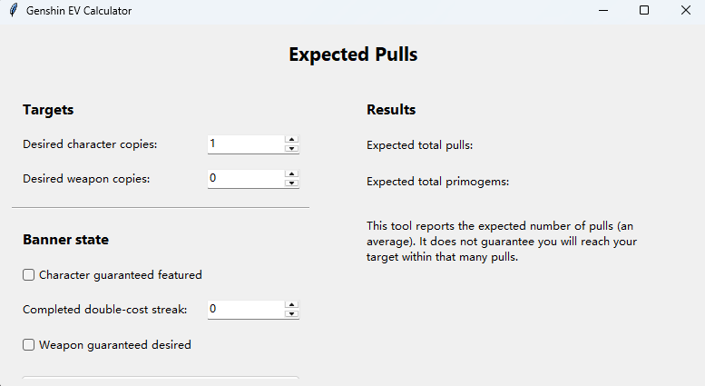

# Genshin Pull Calculator (Expected Value + Probability)

Two small **Tkinter GUI** tools for estimating gacha outcomes in **Genshin Impact**:

- **Expected Value (EV) Calculator** — the *average* number of pulls (and primogems) needed to reach a target number of character and weapon copies.
- **Probability Calculator (Monte Carlo)** — given a fixed pull budget and your current pity state, the probability of reaching that target.

> Not affiliated with HoYoverse. Any gacha model is an approximation; treat the outputs as estimates, not guarantees.

## What's included

### 1. EV calculator — `genshin_expected_pull_calculator.py`



- Computes the expected number of 5★ hits needed for the requested character and weapon copies, taking the 50/50 (consolidated to 55%) and guarantee rules into account.
- Converts expected 5★ hits to expected pulls using the expected pulls per 5★ implied by the pity model (62.3 for characters, 53.3 for weapons).
- Converts pulls to primogems at 160 primogems per pull.
- Does **not** ask for current pity; it uses the unconditional expectation per 5★. Use the probability tool when pity matters.

Sanity checks you can reproduce:

| Target (from zero pity, no guarantee) | Expected pulls | Expected primogems |
| --- | ---: | ---: |
| 1 featured character | 90.3 | 14,453 |
| 1 featured character, already guaranteed | 62.3 | 9,968 |
| 1 desired weapon | 86.5 | 13,845 |
| 1 character + 1 weapon | 176.9 | 28,298 |
| 7 character copies (C6) | 625.5 | 100,088 |

### 2. Probability calculator — `genshin_probability_calculator.py`

- Takes a pull budget and simulates many runs (default 50,000) to estimate the chance of reaching the target.
- Supports **current pity** for both banners (conditioning the first 5★'s timing on pulls already made), the **guaranteed** flag for each banner, and the completed double-cost streak (see below).
- Pulls are spent **characters first, then weapons** from the same budget.
- Reports the estimated probability and an approximate 95% half-width (1.96 × Monte Carlo standard error).

Example: one featured character from zero pity with a 90-pull budget ≈ **63.5%**; with 180 pulls ≈ 100%.

## Gacha model

### 5★ timing (pity)

The pull-by-pull 5★ probability follows the standard soft-pity model, hard-coded as a CDF in both scripts:

| Banner | Base rate | Soft pity | Hard pity |
| --- | ---: | --- | ---: |
| Character | 0.6% | +6 percentage points per pull from pull 74 | 90 |
| Weapon | 0.7% | +7 percentage points per pull from pull 63 | 80 |

### Character banner (featured 5★)

- Each 5★ is the featured character with probability **55%** (the 50% base rate consolidated with Capturing Radiance).
- A miss makes the **next 5★ guaranteed** featured.
- **Capturing Radiance streak (version 5.0+):** the tool tracks consecutive banner characters that each cost two 5★ (miss, then guarantee). After **three** such double-cost characters in a row, the next banner character is guaranteed on the first 5★.

**How to enter the streak:** count only banner characters you have *already obtained* at double cost. A miss you are currently sitting on does not count until the guaranteed copy arrives.

> Example: you completed two double-cost banner characters in a row, then missed again and are now guaranteed but have not yet pulled the character. Enter **Character guaranteed = Yes** and **Completed double-cost streak = 2**, not 3.

### Weapon banner (desired weapon)

- Each 5★ is the desired weapon with probability **37.5%** (two featured weapons at 75% combined).
- A miss makes the next 5★ guaranteed to be the desired weapon (Epitomized Path with one fate point, version 5.0+).
- No streak rule applies to weapons.

## Requirements and usage

Python 3.10+ with Tkinter (bundled with standard Python installers on Windows and macOS; on some Linux distributions install `python3-tk`). No third-party packages.

```bash
python genshin_expected_pull_calculator.py
python genshin_probability_calculator.py
```

Each opens a single window with all inputs visible at once.

## Outputs

| Tool | Reports |
| --- | --- |
| EV calculator | Expected total pulls; expected total primogems (pulls × 160) |
| Probability calculator | Estimated success probability; approximate 95% half-width; number of trials used |

## Project structure

```text
genshin-pull-calculator/
├── genshin_expected_pull_calculator.py
├── genshin_probability_calculator.py
├── README.md
├── docs/
│   └── ev_calculator.png
└── .gitattributes
```

## Limitations

- Models 5★ outcomes only; 4★ pity and the standard banner are not simulated.
- Spending order (characters before weapons) is a modeling choice; a different order changes the probability when the budget is tight.
- The EV tool ignores current pity by design.
- Banner rules are those in effect from version 5.0; earlier versions (50% base rate, two fate points on the weapon banner) would give different numbers.
- Monte Carlo results carry sampling error; raise the trial count for tighter estimates.

## Disclaimer

Provided for personal and educational use as a planning aid. Not affiliated with or endorsed by HoYoverse.
